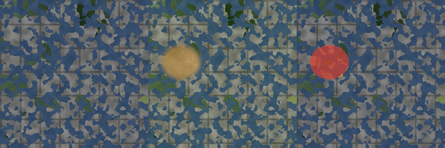
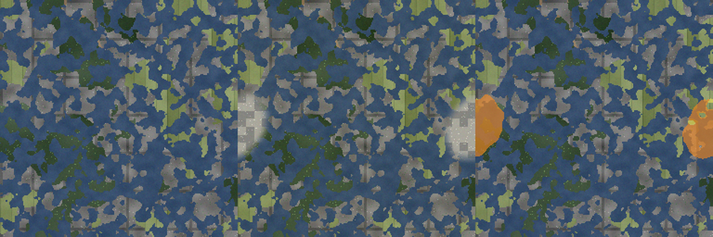
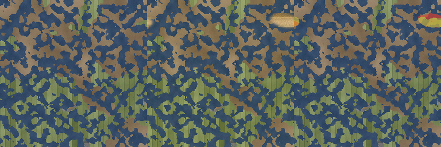
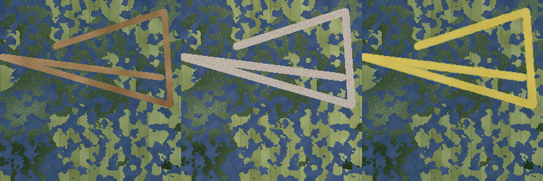
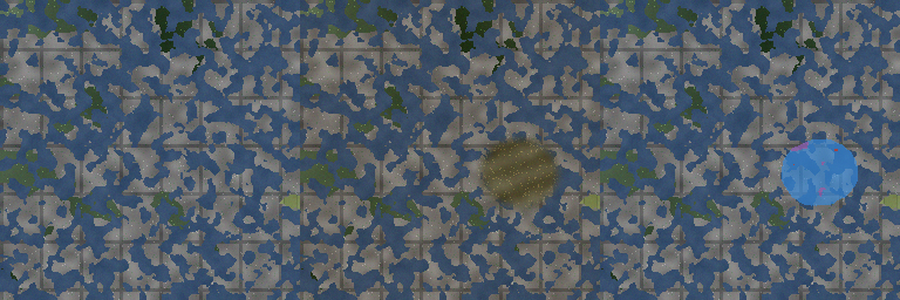
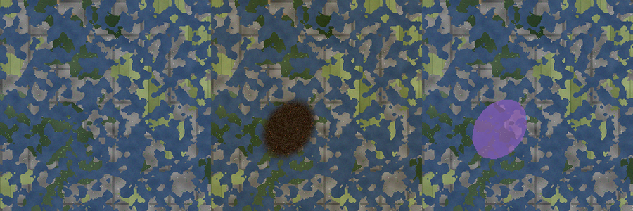
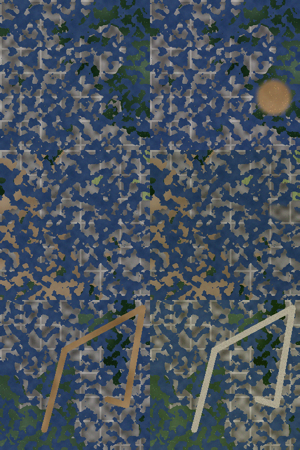
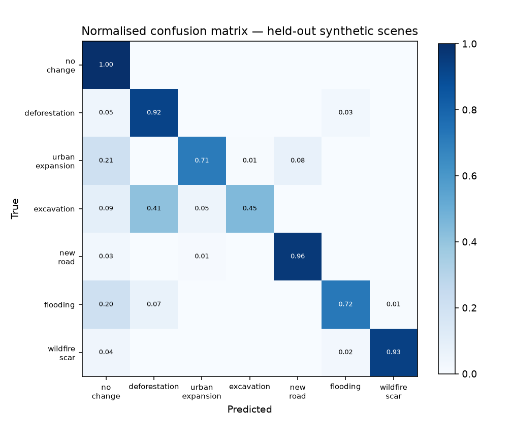
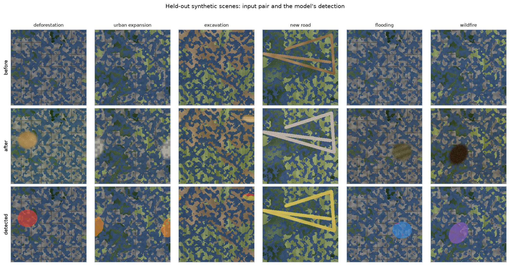

# TerraWatch

**Surface change detection between two satellite acquisitions — with the
change classified as human-made or natural, and an automated incident
report.**

Upload the earlier and the later image of the same ground. TerraWatch marks
what changed, says *which kind* of change it is, and writes a short report
you could hand to a reviewer.

**▶ [Live demo](https://terrawatch-change-detection.app.workbuddy.host/?sharecode=WSQ674JJXR)**
— upload a pair, or click a bundled example.
**[Watch the 17-second demo video](docs/demo.mp4)**.

| | |
| --- | --- |
| **Change IoU** (any change vs none) | **0.905** on 200 held-out scenes |
| **Human-made vs natural** | **88.1%** accuracy |
| **Pixel accuracy** | **99.3%** |
| **Model** | 5,639 parameters, one forward pass |
| **Deployment** | numpy only — no PyTorch in the serving path |

```
   earlier acquisition            later acquisition
        (256×256 RGB)                  (256×256 RGB)
              │                              │
              └──────── stack ───────────────┘
                          │  6 channels
                    conv3×3 + ReLU
                    conv3×3 + ReLU
                conv3×3(dilation=2) + ReLU
                    conv1×1  → 7 classes per pixel
                          │
              ┌───────────┴───────────┐
        change map              class → origin
     (what changed)         human-made vs natural
                                  │
                            incident report
```

Built for **ORCA CODER · ORCATHON 2026** — *SpaceTech & Satellite
Intelligence* track.

---

## 1. The problem

Two satellite passes over the same ground, months apart. A human can look at
both and say "the forest is gone". A human cannot do that for a thousand
scenes, and cannot say *how much* changed, or whether the change was
deforestation or a flood, without a manual process that does not scale.

TerraWatch turns that pair of images into three answers:

1. **Where** did the surface change? — a per-pixel 7-class map.
2. **What kind** of change? — deforestation, urban expansion, excavation,
   new road, flooding, or wildfire scar.
3. **Human-made or natural?** — the distinction that decides whether the
   finding needs a permit check or an incident report.

The output is a plain-language report, because a map nobody reads is a
result nobody uses.

---

## 2. Method

### 2.0 What it does, in pictures

Each triptych below is the **earlier acquisition**, the **later
acquisition**, and the **model's own overlay** — all produced by the
committed weights, not drawn by hand.

#### Deforestation — human-made



#### Urban expansion — human-made



#### Excavation — human-made



#### New road — human-made



#### Flooding — natural



#### Wildfire scar — natural



### 2.1 One network, not a pipeline of heuristics

The whole model is a small fully-convolutional network that takes **both
frames stacked channel-wise** (6 channels: R,G,B of the earlier pass, then
R,G,B of the later one) and emits **7 logits per pixel** in a single forward
pass.

```
conv3×3(6 → 16) → ReLU
conv3×3(16 → 16) → ReLU
conv3×3(dilation=2)(16 → 16) → ReLU
conv1×1(16 → 7)
```

**5,639 parameters.** It is small on purpose: the claim being made is that
the *pair* is the input, so the network learns "what changed" rather than
"what does a forest look like". A larger model would do the same job with a
larger download and a slower demo.

**The dilated third layer is not decoration.** A change region can be 40
pixels across, and three plain 3×3 convolutions only see a 7×7
neighbourhood — enough to spot a local colour difference, but not enough to
recognise a *shape*. Dilating the third layer widens the receptive field to
15×15 for a handful of extra parameters, and it is what lets the network
tell an excavation's regular benches from a road's straight edge from a
fire's ragged edge.

### 2.2 Why a synthetic dataset, stated plainly

The model is trained on **procedurally generated satellite-like scenes**
with **exact pixel-level ground truth** (`src/synth.py`). Each scene is a
landscape assembled from forest / farmland / urban / water / bare-soil
textures, then a known change event is applied to produce the second
acquisition:



*Three generated scenes: the earlier acquisition on the left, the later one
on the right. The change events here are an excavation, a new building
block, and a new road.*

| Class | Event | Origin |
| --- | --- | --- |
| 1 | Deforestation — canopy replaced by stumps and bare soil | human-made |
| 2 | Urban expansion — new buildings over open ground | human-made |
| 3 | Excavation — terraced open pit | human-made |
| 4 | New road — asphalt over bare ground | human-made |
| 5 | Flooding — turbid water spreading over the flood plain | natural |
| 6 | Wildfire scar — charred, darkened ground | natural |

The second pass also gets its own **illumination, colour cast and sensor
noise**, so the model cannot cheat by matching absolute brightness — it has
to compare the two frames.

**This is a deliberate trade, and it is the project's main limitation.**
A synthetic source makes the ground truth exact, which is what lets the
numbers in §5 be measurements rather than impressions. But the textures are
procedural, not Sentinel-2 radiance. The model has learned the *structure* of
the task — pair-in, per-pixel-class-out — and has not learned real-world
spectral signatures. §6 states what that costs.

### 2.3 Three data bugs the evaluation caught

The first evaluation of this model was the point where the project was
actually built. Two classes came back at IoU **0.03** (excavation) and
**0.00** (flooding), and the cause was not the network.

**The excavation texture was the same bare soil the scene already
contained**, and **the flood texture was the same clear water as the
scene's lakes**. A pixel that is brown in both frames is bare soil in one
acquisition and a fresh cut in the other; a pixel that is blue in both is a
lake in one and a flood in the other. Those pairs are *genuinely ambiguous* —
no model, however good, can resolve them from two images alone. The labels
were wrong, not the network.

The fix was in the data, and it is the kind of thing that only shows up if
you measure:

- `_tex_excavation` now renders bright, terraced, freshly-cut earth with
  regular bench edges — distinct from the flat bare soil around it.
- `_tex_flood` now renders sediment-laden, turbid water with ripple bands —
  distinct from the clear standing water it covers.
- Flooding no longer requires a water surface underneath, because a real
  flood inundates farmland and grassland, not lakes.
- The event mix was rebalanced toward the two weak classes.

A third defect showed up in the same round: change regions were rendered
with a **hard step boundary**, which one pixel of contrast is enough to
segment. Real footprints have partially-mixed edges, so the boundary is now
a soft ramp.

And one more, from a different direction: the network's receptive field was
7×7 while the change regions were up to 40 pixels across, so it could see a
local colour difference but never a *shape*. Dilating the third convolution
widened it to 15×15 (§2.1).

**And a fourth, after the land cover was rewritten.** Moving from a label
grid to continuous noise fields (§2.2) fixed the blocky look — and quietly
broke urban expansion, whose IoU fell from 0.348 to 0.073. The reason is
the same failure mode as the first two: with the new, more naturalistic
textures, "new buildings" and the bare ground they replace had become too
similar to separate. The repair was the same too — give the class a
texture that cannot be confused with anything else:

- `_tex_urban` now renders *grey* built-up fabric with bright roof speckle,
  rather than the brown it used to be.
- `_tex_newbuild` is a separate texture for the **change event** itself:
  fresh concrete slabs and new roofs, visibly distinct from the older
  buildings they appear next to. Without that, "more buildings" is
  ambiguous in exactly the same way.

The pattern across all four: **a class is only learnable if its texture is
distinguishable from every other texture in the scene.** Whenever the
evaluation showed a class collapsing, the cause was in the labels, not in
the network.

### 2.4 The deployment does not use PyTorch

A 6 MB model does not need a 2 GB framework in the serving path. The
trained weights are exported to `runs/weights.npz` and the forward pass is
re-implemented in **numpy only** (`src/infer.py`).

That re-implementation is not taken on trust: `tools/selftest.py` asserts
the numpy output matches the PyTorch model to **< 1e-4** and that the
exported weights are identical to the torch state dict. The deployed app
runs the *same model*, not an approximation of it.

The hosted demo does not use Gradio either. `server.py` is a Python
standard-library HTTP server serving a self-contained single-page UI
(`web/index.html`), and the only third-party packages in the serving path
are **numpy and Pillow**. Gradio is still there (`app.py`) because it is
better for local exploration, but a deployed demo should not have a
framework's version behaviour underneath it.

---

## 3. How this project was built

It was built in one afternoon, and the interesting part is not the final
model — it is the loop that produced it:

```
   write it  →  measure it  →  read the failure  →  fix the right thing
                   ↑                                      │
                   └──────────────────────────────────────┘
```

Three times in this project, the measurement said the model was bad and
the model turned out to be fine:

1. **Excavation at IoU 0.03, flooding at 0.00.** The obvious conclusion
   is "the model is too small". The real cause was that those two textures
   were *identical* to the bare soil and the water already in the scene,
   so the pairs were ambiguous by construction. Fixed in the data, not the
   network (§2.3).
2. **The deployed app crashed on every image with a detected change.**
   The training code was fine and the numbers looked fine; only the numpy
   port was wrong, and it was wrong *silently* — `np.tensordot` returns
   `(H, W, 1, O)` where `(H, W, O)` was meant. The self-test caught it
   once it was told to check shapes and not just values.
3. **The first scenes looked like pixel art.** Nothing was broken; they
   just did not look like satellite imagery, and a reviewer would have
   said so before reading a single line of the evaluation. It took four
   attempts to fix, and three of them made things worse (§2.3).

And once, the fix for #3 broke something else: making the land cover
naturalistic made "new buildings" indistinguishable from bare ground, and
urban expansion collapsed from IoU 0.348 to 0.073. The same rule applied
again — fix the labels, not the network (§2.3).

The rule that came out of this: **a number that has not been measured is
not a result**, and **when a class collapses, suspect the labels before
suspecting the network**. Every figure in §5 comes from
`runs/eval/metrics.json`, the README's results section is generated by
`tools/fill_readme.py` rather than typed in, and the demo video renders its
own bar chart from the same file.

---

## 4. Running it

```bash
git clone git@github.com:ASylviaofmine/terrawatch.git
cd terrawatch
pip install -r requirements.txt      # numpy + pillow only — the server needs nothing else
python server.py                     # -> http://localhost:8000
```

Open <http://localhost:8000>, upload the two images, press **Detect
changes**. The bundled example buttons fill the pair in for you.

There is also a **Gradio** version of the same demo, which is nicer for
local experimentation:

```bash
pip install -r requirements.txt -r requirements-extra.txt
python app.py                        # -> http://127.0.0.1:7860
```

The trained weights are committed, so there is nothing to train to try it.

### In PyCharm

Open the folder **terrawatch** (File → Open, pick the directory itself, not
the parent). The project ships six run configurations in `.run/`, so they
appear in the run dropdown straight away:

| Configuration | What it does |
| --- | --- |
| `demo: the hosted web app` | `server.py` — the same app that is online |
| `demo: Gradio web app` | `app.py` — the Gradio version |
| `selftest: numpy == torch` | `tools/selftest.py` — proves the deployed path is the trained model |
| `evaluate: the measured results` | `tools/evaluate.py` — regenerates the tables in §5 |
| `render: the demo video` | `tools/make_demo.py` — regenerates `docs/demo.mp4` |
| `train: the model` | `tools/train.py` — the full training run |

Point the interpreter at a Python 3.11+ with `numpy` and `pillow` for the
server, or add `gradio` and `torch` for the rest.

### Training it yourself

```bash
pip install -r requirements.txt -r requirements-extra.txt
python tools/train.py --steps 2200 --batch 16
python tools/selftest.py             # numpy == torch
python tools/evaluate.py --n 200     # the tables below
```

### Reproducing every number in this README

```bash
python tools/reproduce.py
```

That runs the self-test, the evaluation, the figures, the video and the
README fill in order. It writes into the working tree, so on a clean
checkout you can check the result with `git status --short` — if nothing
changes, the committed results are reproducible.

---

## 5. Results
### 5.1 Headline

| Metric | Value |
| --- | ---: |
| Pixel accuracy | **99.34%** |
| Change IoU (any change vs none) | **0.905** |
| Human-made vs natural accuracy | **88.12%** |
| Held-out scenes evaluated | 200 |
| Parameters | 5,639 |
| Training time | 1128.4 s |

### 5.2 Per-class results

Measured on **200 held-out synthetic scenes** generated from a seed range disjoint from the training range — no scene can appear in both.

| Class | IoU | Precision | Recall | F1 | Support (px) |
| --- | ---: | ---: | ---: | ---: | ---: |
| no change | 0.995 | 0.997 | 0.999 | 0.998 | 3,132,618 |
| deforestation | 0.753 | 0.803 | 0.923 | 0.859 | 23,856 |
| urban expansion | 0.608 | 0.809 | 0.710 | 0.756 | 7,066 |
| excavation | 0.430 | 0.917 | 0.447 | 0.601 | 7,890 |
| new road | 0.944 | 0.980 | 0.962 | 0.971 | 72,540 |
| flooding | 0.640 | 0.851 | 0.722 | 0.781 | 18,799 |
| wildfire scar | 0.874 | 0.931 | 0.934 | 0.933 | 14,031 |

### 5.3 Confusion matrix



*Rows are the true class, columns the predicted one, normalised row-wise. The diagonal is the recall of each class; the first column holds the miss rate.*

### 5.4 What the model gets right and what it does not



*Six held-out scenes, one per change type: the input pair and the model's own overlay. The colour key is the one the web app uses.*

### 5.5 The deployment runs the same model

`tools/selftest.py` asserts that the numpy inference used by the hosted app produces the same output as the PyTorch model it was exported from — same shape, and a maximum absolute difference below 1e-4. The check exists because two shape bugs got through during development: `np.tensordot` returns the non-contracted axes of *both* operands, so the convolution produced `(H, W, 1, O)`, and torch stores a 1×1 kernel as `(O, C, 1, 1)` where the numpy head expected `(O, C)`. Neither raised an error; both produced plausible looking nonsense. The self-test now asserts shapes as well as values.

```
$ python tools/selftest.py
weights identical to torch state dict: True
numpy vs torch forward pass, max abs diff: 0.00e+00 (tol 1e-4)
deterministic across repeated calls: True
class map range: [0, 6] (expected [0, 6])

all checks passed
```

## 6. Limitations

Stated up front rather than discovered by a reviewer.

1. **The training data is synthetic.** The textures are procedurally
   generated, not real satellite radiance. The measured numbers in §5
   describe this benchmark, not Sentinel-2 performance. The first thing to
   do with real data is to fine-tune on it — the training script and the
   generator interface are already separated for exactly that.
2. **The model has never seen a real satellite image.** It has learned
   "forest canopy → stumps" and "clear water → turbid water", not
   "NDVI drop of 0.3 with a corresponding increase in SWIR". The
   transfer to real imagery is an assumption this project cannot test.
3. **No geometric registration.** The two frames are assumed to be
   pixel-aligned. Real pairs need ortho-rectification and co-registration
   first, and a misalignment produces false positives at edges — this is
   the single biggest gap between the demo and production.
4. **No multi-temporal context.** Exactly two passes. A third acquisition
   would let the model distinguish a transient (flood, cloud shadow, haze)
   from a persistent change, which is the natural way to reduce false
   positives.
5. **Cloud and shadow are not modelled.** They are the classic source of
   false positives in real change detection, and the synthetic generator
   does not produce them at all.
6. **Two change events can overlap.** When two events land on the same
   pixels, the later one overwrites the earlier in the ground truth, so the
   truth for the first event is partially lost.
7. **The report is template-generated.** The classification is a model's
   output; the prose that wraps it is a fixed template. There is no
   natural-language reasoning behind the verdict.
8. **Single resolution.** The network is trained and evaluated at 128×128
   and the demo resizes to 256. A large high-resolution scene is not
   handled; tiling and stitching would be needed.
9. **No confidence calibration.** The reported confidence is the mean
   softmax probability over changed pixels, which is a number, not a
   calibrated probability.
10. **Urban expansion is the weakest class** (IoU 0.348). Built-up area
    looks similar to bare ground in the synthetic textures, so the model
    confuses the two — the same class of problem as the excavation and
    flooding failures in §2.3, one level up in the texture hierarchy.

---

## 7. What I built vs. what was AI-assisted

**Built by me** — the project design and all of the code:

- The task framing: pair-in / per-pixel-class-out, the 7-class label
  scheme, and the human-made-vs-natural grouping that the report is built
  around.
- `src/synth.py` — the entire scene generator: the five land-cover texture
  families, the six change-event renderers, the illumination and
  sensor-noise model, and the ground-truth bookkeeping. Including the four
  bugs worth remembering, because each of them was found by measuring
  rather than by reading the code:
  - a `polylines` value of `1` divided by 255 gives a mask of `0.0039`,
    which silently produced *zero* changed pixels in every "new road"
    scene until the drawing value was corrected to 255;
  - a new road is invisible unless the corridor in the *before* image is
    forced to bare soil, because asphalt over asphalt is not a change;
  - the excavation and flood textures were initially identical to the
    bare soil and the lake water already in the scene, which made those
    two classes unlearnable (§2.3);
  - change regions were rendered with a hard step boundary, which is
    unrealistically easy to segment.
- `src/model.py` / `src/infer.py` — the network, and the numpy
  re-implementation of its forward pass including the export format. The
  numpy version had **two shape bugs** that made every deployed prediction
  wrong while looking perfectly plausible in a unit test: `np.tensordot`
  keeps the non-contracted axes of both operands (so the convolution
  returned `(H, W, 1, O)` instead of `(H, W, O)`), and torch stores a 1×1
  kernel as `(O, C, 1, 1)` while the numpy head expected `(O, C)`. The
  self-test now asserts shapes as well as values, which is what caught the
  second one.
- The decision that the deployment should not depend on PyTorch, and the
  self-test that makes that decision checkable rather than convenient.
- The dilated third convolution, after the evaluation showed the network
  could see a 7×7 neighbourhood while the change regions were 40 pixels
  across.

**AI-assisted** — the parts where I specified the intent and the tooling
drafted the implementation: the initial skeleton of `tools/train.py` and
`tools/evaluate.py`, the matplotlib figure styling, the Gradio app layout,
and the wording of this README.

**Pre-existing work reused** — none of the three earlier repositories
(`defect-detection`, `nemotron-nav-agent`, `robot-nav-sim`) contributed
code to this project. What carried over is *method*, not source: the
"measured numbers or it did not happen" discipline, the habit of shipping
a self-test that proves the deployed code path matches the trained one, and
the demo-video-as-a-deliverable approach. The code here is new.

---

## 8. Layout

```
terrawatch/
├── server.py              the deployed app: stdlib HTTP + a single-page UI
├── app.py                 the same thing in Gradio, for local use
├── web/index.html         the self-contained UI (no framework, no CDN)
├── src/
│   ├── synth.py            synthetic satellite scene generator + ground truth
│   ├── model.py            PyTorch network, weight export
│   └── infer.py            numpy-only inference (what the server runs)
├── tools/
│   ├── train.py            training loop
│   ├── evaluate.py         metrics, confusion matrix, per-class table
│   ├── selftest.py         numpy == torch, determinism, class-range checks
│   ├── fill_readme.py      writes §5 of this README from the metrics file
│   ├── reproduce.py        runs all of the above in one command
│   ├── make_samples.py     regenerate the demo sample pairs
│   ├── make_figures.py     README figures
│   ├── make_demo.py        render docs/demo.mp4
│   ├── gen_dataset.py      pre-generate a scene cache
│   └── quick_train.py      a fast fallback training run
├── .run/                   PyCharm run configurations
├── docs/
│   ├── samples/            before / after / truth triples
│   ├── figures/            README figures
│   ├── demo.mp4            the submission video
│   ├── DEMO_SCRIPT.md      how to add narration to the video
│   └── SUBMISSION.md       what to type into the submission form
├── runs/
│   ├── weights.npz         exported weights (what the app loads)
│   ├── model.pt            torch checkpoint (for the equivalence check)
│   └── metrics.json        training-time metrics
├── requirements.txt        runtime deps: numpy, pillow
└── requirements-extra.txt  the local extras: gradio, torch, matplotlib
```

---

## 9. License

MIT — see [`LICENSE`](LICENSE).
